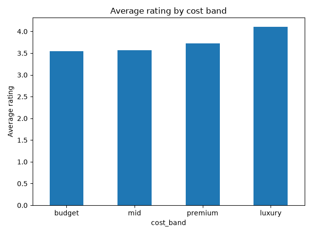
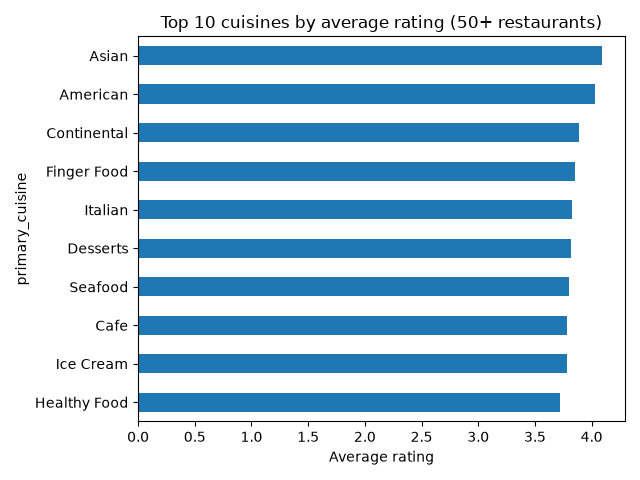
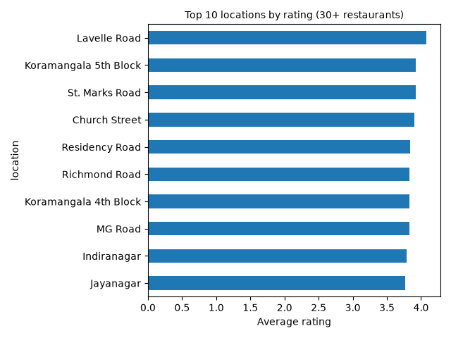
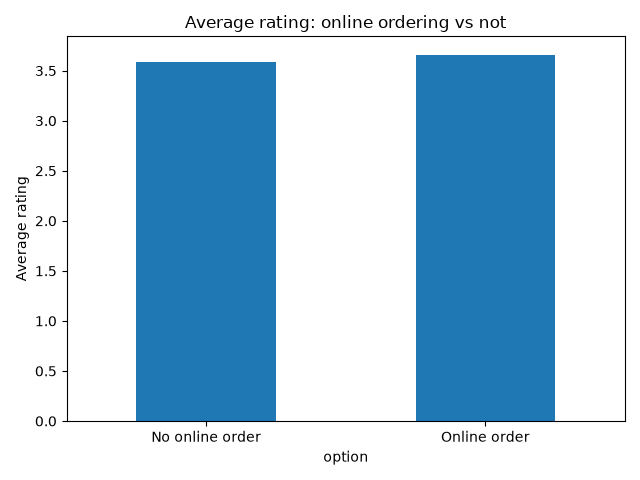
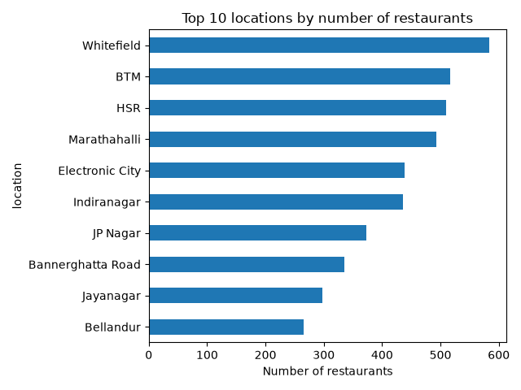

# Zomato Bangalore Restaurant Data Pipeline

An end-to-end batch ETL pipeline in Python and SQLite. It cleans the Zomato Bangalore restaurants dataset, loads it into a database, and answers business questions with SQL and charts.

## Dataset

- **Source:** Zomato Bangalore Restaurants (Kaggle), 2019 snapshot
- **Size:** 51,717 listings, 17 columns (11 columns are used)
- **Not included in this repo** because the CSV is 574 MB. Download it from Kaggle and place it at `data/raw/zomato.csv`.

## Pipeline stages

```
Extract -> Clean -> Transform -> Load (SQLite) -> Analyze (SQL + charts)
```

| Stage | File | What it does |
|-------|------|--------------|
| Extract | `src/extract.py` | Reads 11 needed columns from the raw CSV (the raw file is never modified) |
| Clean | `src/clean.py` | Fixes data types, removes duplicates and rows with missing values, logs every rule |
| Transform | `src/transform.py` | Deduplicates restaurants, adds `primary_cuisine`, `rating_band`, `cost_band`, converts Yes/No to 1/0 |
| Load | `src/load.py` | Writes the result to `db/pipeline.db` (re-running replaces the table, so no duplicates) |
| Analyze | `src/analyze.py` | Reads only from the database, runs SQL queries, saves charts |

`main.py` runs all stages in order.

## Data cleaning

| Rule | Rows removed | Why |
|------|-------------:|-----|
| Exact duplicate rows | 108 | Same record twice |
| No valid rating (`NEW`, `-`, blank) | 10,019 | A rating that does not exist cannot be averaged |
| Missing cost, location or cuisine | 253 | Needed for the analysis |

Other cleaning steps:
- `rate` converted from text such as `4.1/5` and `3.9 /5` to numbers
- `approx_cost(for two people)` converted from text such as `1,200` to numbers

### Row funnel

| Step | Rows |
|------|-----:|
| Extracted | 51,717 |
| After cleaning | 41,337 |
| After deduplicating by name + location | **9,216** |

Deduplication keeps the listing with the most votes for each restaurant name and location. The same restaurant appears under several service types, so without this step every average was inflated by repeated listings.

### Validation after cleaning

- Ratings range from 1.8 to 4.9 (valid range is 0 to 5)
- Cost ranges from 40 to 6,000 (median 400). Outliers were kept because they are plausible
- 92 distinct locations, none with stray spaces

## Key findings

1. **Luxury restaurants rate highest (4.11).** Budget (3.55) and mid (3.57) are almost identical, so the jump happens at the top.
2. **Asian (4.09) and American (4.03) are the best-rated cuisines.** Each has only about 60 restaurants, so the averages are less reliable than for large groups such as Continental (3.89, n=286).
3. **Lavelle Road is the best-rated area (4.08).** St. Marks Road and Koramangala 5th Block follow at 3.92.
4. **Online ordering shows a small edge (3.66 vs 3.59).** The gap is too small to claim it improves ratings.
5. **Whitefield (584), BTM (516) and HSR (509) have the most restaurants.**

### Charts







## Limitations

- Only rated restaurants are included. New and unrated places are missing, so results describe established restaurants only.
- Findings show correlation, not causation. For example, price may not cause higher ratings.
- Cost bands (300, 600, 1000) are arbitrary cut-offs.
- Deduplicating by name + location merges chain outlets in the same area.
- Groups of about 50 restaurants can swing an average.
- The data is a 2019 snapshot, so ratings and prices may be outdated.
- The pipeline is a manual batch process. It is not scheduled or real-time.

## How to run

```bash
# 1. Create and activate a virtual environment
python -m venv venv
venv\Scripts\activate          # Windows
# source venv/bin/activate     # Mac / Linux

# 2. Install dependencies
pip install -r requirements.txt

# 3. Place the dataset at data/raw/zomato.csv, then run the pipeline
python main.py

# 4. Run the tests
python -m pytest -v
```

Charts are saved to `outputs/charts/` and the database to `db/pipeline.db`.

## Tests

`tests/test_pipeline.py` has 4 tests:
- rating and cost parsing in `clean.py`
- exact duplicate removal
- keeping the highest-voted listing per restaurant
- idempotent load (running twice does not duplicate rows)

## Helper scripts

These are not pipeline stages. They were used to inspect and validate the data:
- `src/inspect_data.py`: first look at the raw file (shape, types, nulls)
- `src/check_db.py`: reads the loaded table back to confirm the load
- `src/check_clean.py`: range and consistency checks on the cleaned data

## Tech stack

Python, pandas, SQLite, matplotlib, pytest

